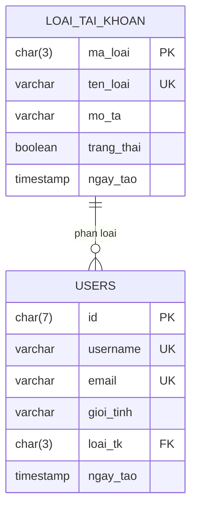

# Mini-Netflix

Đồ án cơ sở dữ liệu — hệ thống quản lý phim trực tuyến.

## Công nghệ

- PostgreSQL 18

## Sơ đồ CSDL



### Mô tả các bảng

| Bảng | Mô tả |
|---|---|
| `loai_tai_khoan` | Danh mục loại tài khoản (quản trị viên, kiểm duyệt viên, người dùng) |
| `users` | Tài khoản người dùng, mỗi tài khoản thuộc đúng một loại |

Quan hệ: một loại tài khoản có nhiều users (1–N), nối qua `users.loai_tk → loai_tai_khoan.ma_loai`.

## Cài đặt

```bash
createdb Mini-Netflix
psql -d Mini-Netflix -f schema.sql
```

## Cấu trúc thư mục

```
schema.sql     Script tạo bảng (nguồn chân lý của CSDL)
docs/
  erd.png      Sơ đồ ERD xuất từ pgAdmin (dùng cho báo cáo)
  erd.pgerd    File gốc, mở lại bằng pgAdmin ERD Tool
```
