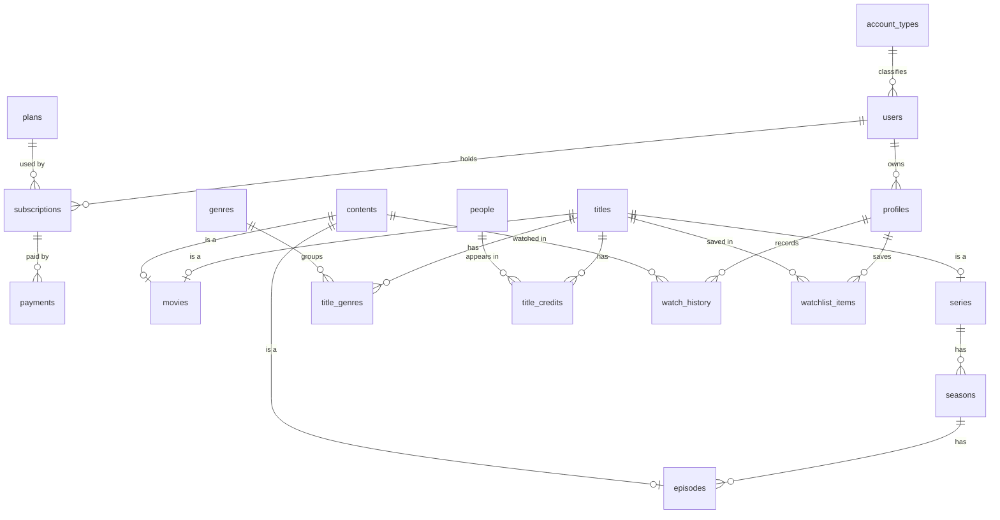

# Mini-Netflix

Đồ án cơ sở dữ liệu — hệ thống quản lý phim trực tuyến.

## Công nghệ

- PostgreSQL 18
- Extension có sẵn trong bộ cài PostgreSQL: `btree_gist`, `pg_trgm`, `pgcrypto`

## Sơ đồ CSDL



### Mô tả các bảng

| Bảng | Mô tả |
|---|---|
| `account_types` | Danh mục loại tài khoản (quản trị viên, kiểm duyệt viên, người dùng) |
| `users` | Tài khoản người dùng, mỗi tài khoản thuộc đúng một loại |
| `profiles` | Hồ sơ xem của một tài khoản (thực thể yếu của `users`) |
| `plans` | Gói dịch vụ: giá, số hồ sơ tối đa, chất lượng video |
| `subscriptions` | Đăng ký gói theo khoảng thời gian, không được trùng ngày |
| `payments` | Các lần thanh toán của một đăng ký |
| `titles` | Tác phẩm để hiển thị và theo dõi: phim lẻ hoặc phim bộ |
| `series` | Phim bộ |
| `seasons` | Mùa phim (thực thể yếu của `series`) |
| `contents` | Video xem được, lớp cha của `movies` và `episodes` |
| `movies` | Phim lẻ, vừa là một `contents` vừa là một `titles` |
| `episodes` | Tập phim thuộc một mùa |
| `genres` | Danh mục thể loại |
| `title_genres` | Quan hệ nhiều-nhiều giữa tác phẩm và thể loại |
| `people` | Diễn viên, đạo diễn |
| `title_credits` | Vai trò của một người trong một tác phẩm |
| `watch_history` | Lịch sử xem theo hồ sơ, mỗi dòng là một lần xem |
| `watchlist_items` | Danh sách theo dõi của hồ sơ |

Chi tiết cột và ràng buộc nằm trong [SQL/01_tables.sql](SQL/01_tables.sql).

## Cài đặt

Chạy các script theo đúng thứ tự:

```bash
createdb Mini-Netflix
psql -d Mini-Netflix -v ON_ERROR_STOP=1 -f SQL/01_tables.sql
psql -d Mini-Netflix -v ON_ERROR_STOP=1 -f SQL/02_indexes.sql
psql -d Mini-Netflix -v ON_ERROR_STOP=1 -f SQL/03_triggers.sql
psql -d Mini-Netflix -v ON_ERROR_STOP=1 -f SQL/04_views.sql
psql -d Mini-Netflix -v ON_ERROR_STOP=1 -f SQL/05_seed_users.sql
psql -d Mini-Netflix -v ON_ERROR_STOP=1 -f SQL/06_seed_sample_data.sql
```

## Cấu trúc thư mục

```
SQL/
  01_tables.sql    Tạo bảng và ràng buộc (nguồn chân lý của CSDL)
  02_indexes.sql   Tạo chỉ mục
  03_triggers.sql  Trigger cho các quy tắc nghiệp vụ
  04_views.sql     Tạo view
  05_seed_users.sql  Dữ liệu mẫu cho account_types và users
  06_seed_sample_data.sql  Dữ liệu mẫu tiếng Việt: tài khoản, gói, phim, lịch sử xem
Requirement/       Tài liệu yêu cầu của môn học
ERD Mini Nextfix.pgerd  File sơ đồ, mở bằng pgAdmin ERD Tool (chưa cập nhật theo lược đồ mới)
```
