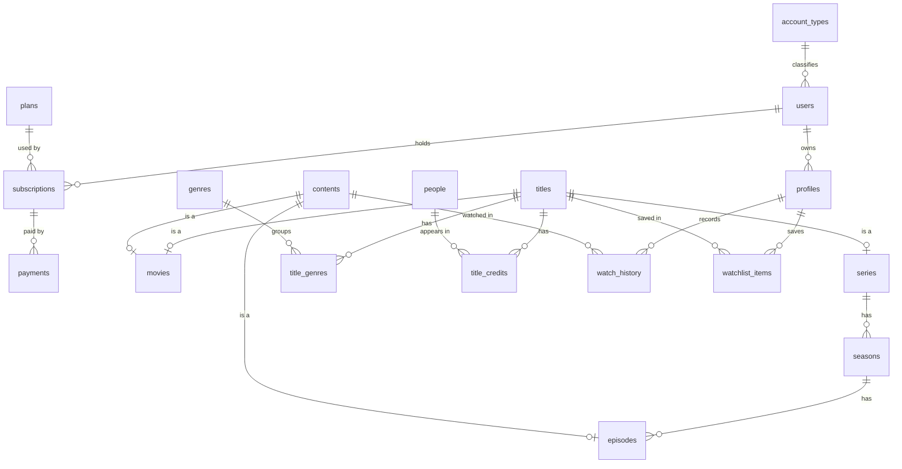

# Mini-Netflix

Đồ án cơ sở dữ liệu — hệ thống quản lý phim trực tuyến.

## Công nghệ

- PostgreSQL 18
- Extension có sẵn trong bộ cài PostgreSQL: `btree_gist`, `pg_trgm`, `pgcrypto`

## Sơ đồ CSDL



### Mô tả các bảng

| Bảng | Mô tả |
|---|---|
| `account_types` | Danh mục loại tài khoản (quản trị viên, kiểm duyệt viên, người dùng) |
| `users` | Tài khoản người dùng, mỗi tài khoản thuộc đúng một loại |
| `profiles` | Hồ sơ xem của một tài khoản (thực thể yếu của `users`) |
| `plans` | Gói dịch vụ: giá, số hồ sơ tối đa, chất lượng video |
| `subscriptions` | Đăng ký gói theo khoảng thời gian, không được trùng ngày |
| `payments` | Các lần thanh toán của một đăng ký |
| `titles` | Tác phẩm để hiển thị và theo dõi: phim lẻ hoặc phim bộ |
| `series` | Phim bộ |
| `seasons` | Mùa phim (thực thể yếu của `series`) |
| `contents` | Video xem được, lớp cha của `movies` và `episodes` |
| `movies` | Phim lẻ, vừa là một `contents` vừa là một `titles` |
| `episodes` | Tập phim thuộc một mùa |
| `genres` | Danh mục thể loại |
| `title_genres` | Quan hệ nhiều-nhiều giữa tác phẩm và thể loại |
| `people` | Diễn viên, đạo diễn |
| `title_credits` | Vai trò của một người trong một tác phẩm |
| `watch_history` | Lịch sử xem theo hồ sơ, mỗi dòng là một lần xem |
| `watchlist_items` | Danh sách theo dõi của hồ sơ |

Chi tiết cột và ràng buộc nằm trong [SQL/01_tables.sql](SQL/01_tables.sql).

## Cài đặt

Chạy các script theo đúng thứ tự:

```bash
createdb Mini-Netflix
psql -d Mini-Netflix -v ON_ERROR_STOP=1 -f SQL/01_tables.sql
psql -d Mini-Netflix -v ON_ERROR_STOP=1 -f SQL/02_indexes.sql
psql -d Mini-Netflix -v ON_ERROR_STOP=1 -f SQL/03_triggers.sql
psql -d Mini-Netflix -v ON_ERROR_STOP=1 -f SQL/04_views.sql
psql -d Mini-Netflix -v ON_ERROR_STOP=1 -f SQL/05_seed_users.sql
psql -d Mini-Netflix -v ON_ERROR_STOP=1 -f SQL/06_seed_sample_data.sql
psql -d Mini-Netflix -v ON_ERROR_STOP=1 -f SQL/08_roles.sql
psql -d Mini-Netflix -v ON_ERROR_STOP=1 -f SQL/09_seed_more_data.sql
```

`08_roles.sql` cần quyền superuser vì tạo vai trò. `09_seed_more_data.sql` thêm khoảng 3 700 dòng dữ liệu mẫu, chỉ chạy một lần ngay sau `06`. Truy vấn mẫu nằm ở `SQL/07_queries.sql` và chỉ đọc dữ liệu.

## Kiểm thử

Các script trong `SQL/tests/` tự hoàn tác (`ROLLBACK`), nên không làm đổi dữ liệu:

```bash
psql -d Mini-Netflix -f SQL/tests/constraint_tests.sql
psql -d Mini-Netflix -f SQL/tests/rbac_tests.sql
```

`performance_tests.sql` thêm khoảng 470 000 dòng và tạm xóa chỉ mục trong lúc chạy, nên chỉ chạy trên một database thử.

## Cấu trúc thư mục

```
SQL/
  01_tables.sql    Tạo bảng và ràng buộc (nguồn chân lý của CSDL)
  02_indexes.sql   Tạo chỉ mục
  03_triggers.sql  Trigger cho các quy tắc nghiệp vụ
  04_views.sql     Tạo view
  05_seed_users.sql  Dữ liệu mẫu cho account_types và users
  06_seed_sample_data.sql  Dữ liệu mẫu tiếng Việt: tài khoản, gói, phim, lịch sử xem
  07_queries.sql   14 truy vấn nâng cao
  08_roles.sql     Phân quyền theo vai trò (GRANT/REVOKE)
  09_seed_more_data.sql  Thêm khoảng 3 700 dòng dữ liệu mẫu tiếng Việt
  tests/
    constraint_tests.sql   Kiểm tra ràng buộc và trigger
    rbac_tests.sql         Kiểm tra phân quyền
    performance_tests.sql  Đo hiệu năng chỉ mục
docs/
  1_introduction_scope.md  Mục tiêu, phạm vi, yêu cầu, quy tắc nghiệp vụ (báo cáo mục 1)
  2.1_conceptual_model.md  Mô tả mô hình khái niệm EER (mục 2.1)
  2.2_logical_mapping.md  Ánh xạ EER sang lược đồ quan hệ (mục 2.2)
  2.3_normalization.md    Phụ thuộc hàm và chứng minh chuẩn hóa (mục 2.3)
  3_data_dictionary.md    Từ điển dữ liệu 18 bảng (mục 3)
  4_implementation.md     Cài đặt, truy vấn nâng cao, hiệu năng (mục 4)
  5_verification_security.md  Kiểm thử ràng buộc và phân quyền (mục 5)
notebook/
  eer_diagram.png  Sơ đồ EER (ký hiệu Elmasri)
  physical_erd.png Sơ đồ vật lý Crow's Foot (kèm .svg và mã nguồn .mmd)
Requirement/       Tài liệu yêu cầu của môn học
```
