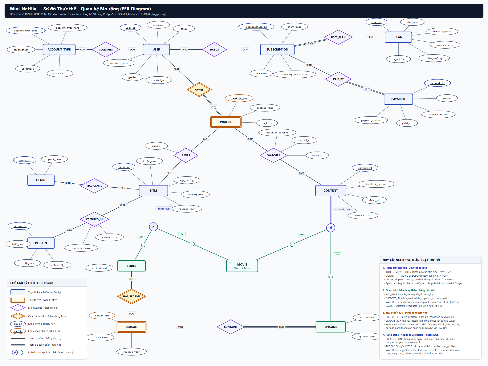

# 2.1. Mô hình khái niệm (Conceptual Model)

Mô hình khái niệm được vẽ bằng ký hiệu EER của Elmasri & Navathe, trong [notebook/eer_diagram.png](../notebook/eer_diagram.png) (bản vector: [eer_diagram.svg](../notebook/eer_diagram.svg)).

**Ký hiệu dùng trong sơ đồ:**

| Ký hiệu | Ý nghĩa |
|---|---|
| Hình chữ nhật nét đơn | Thực thể mạnh |
| Hình chữ nhật nét đôi | Thực thể yếu |
| Hình thoi nét đơn | Mối quan hệ |
| Hình thoi nét đôi | Quan hệ xác định của thực thể yếu |
| Thuộc tính gạch chân liền | Khóa |
| Thuộc tính gạch chân đứt | Khóa riêng phần |
| Nét đôi | Tham gia toàn phần |
| Vòng tròn `d` kèm ký hiệu ⊂ | Phân lớp rời nhau (disjoint); nét đôi từ lớp cha tới vòng tròn là phân lớp toàn phần |

Cặp `(min, max)` cạnh mỗi thực thể cho biết một thực thể đó tham gia ít nhất và nhiều nhất bao nhiêu lần vào mối quan hệ.

## 2.1.1. Thực thể và thuộc tính

### Thực thể mạnh

| Thực thể | Khóa | Thuộc tính khác | Ý nghĩa |
|---|---|---|---|
| ACCOUNT_TYPE | account_type_code | account_type_name, description, is_active, created_at | Loại tài khoản: quản trị viên, kiểm duyệt viên, người dùng |
| USER | user_id | username, email, password_hash, gender, created_at | Tài khoản đăng nhập |
| PLAN | plan_id | plan_name, monthly_price, max_profiles, video_quality, is_active | Gói dịch vụ |
| SUBSCRIPTION | subscription_id | start_date, end_date, subscription_status | Một lần đăng ký gói trong một khoảng ngày |
| PAYMENT | payment_id | amount, payment_method, paid_at, payment_status | Một giao dịch thanh toán |
| TITLE | title_id | title_type, title_name, description, release_year, age_rating | Tác phẩm hiển thị trong danh mục (lớp cha) |
| CONTENT | content_id | content_type, duration_seconds, video_url, release_date | Video xem được (lớp cha) |
| GENRE | genre_id | genre_name | Thể loại |
| PERSON | person_id | full_name, birth_date, nationality | Đạo diễn, diễn viên |

`username`, `email`, `plan_name`, `genre_name` và `account_type_name` cũng là thuộc tính duy nhất, tức khóa ứng viên.

### Thực thể yếu

| Thực thể yếu | Thực thể chủ | Quan hệ xác định | Khóa riêng phần | Thuộc tính khác |
|---|---|---|---|---|
| PROFILE | USER | OWNS | profile_num | profile_name, is_kids |
| SEASON | SERIES | HAS_SEASON | season_num | season_name, release_year |

**Vì sao là thực thể yếu:**
- **PROFILE:** hồ sơ chỉ có nghĩa trong một tài khoản. "Hồ sơ số 2" chỉ xác định được khi biết là của tài khoản nào.
- **SEASON:** "Mùa 1" chỉ xác định được khi biết thuộc phim bộ nào.

### Lớp con

| Lớp con | Lớp cha | Thuộc tính riêng |
|---|---|---|
| SERIES | TITLE | is_finished |
| MOVIE | TITLE và CONTENT (lớp con dùng chung) | Không có, ngoài khóa của hai lớp cha |
| EPISODE | CONTENT | episode_num, episode_name; khóa ứng viên (title_id, season_num, episode_num) |

## 2.1.2. Mối quan hệ và ràng buộc lực lượng

| Quan hệ | Thực thể (min, max) | Thực thể (min, max) | Loại | Thuộc tính của quan hệ | Ý nghĩa |
|---|---|---|---|---|---|
| CLASSIFIES | ACCOUNT_TYPE (0, N) | USER (1, 1) | 1:N | | Mỗi tài khoản thuộc đúng một loại; một loại có thể chưa có tài khoản nào |
| HOLDS | USER (0, N) | SUBSCRIPTION (1, 1) | 1:N | | Mỗi lần đăng ký thuộc đúng một tài khoản; tài khoản có thể chưa đăng ký |
| USES_PLAN | SUBSCRIPTION (1, 1) | PLAN (0, N) | N:1 | | Mỗi lần đăng ký dùng đúng một gói |
| PAID_BY | SUBSCRIPTION (0, N) | PAYMENT (1, 1) | 1:N | | Mỗi giao dịch thuộc đúng một lần đăng ký; một lần đăng ký có thể có nhiều giao dịch (thất bại, thành công, hoàn tiền) |
| OWNS | USER (0, N) | PROFILE (1, 1) | 1:N, xác định | | Mỗi hồ sơ thuộc đúng một tài khoản |
| HAS_SEASON | SERIES (0, N) | SEASON (1, 1) | 1:N, xác định | | Mỗi mùa thuộc đúng một phim bộ; phim bộ mới tạo có thể chưa có mùa |
| CONTAINS | SEASON (0, N) | EPISODE (1, 1) | 1:N | | Mỗi tập thuộc đúng một mùa |
| HAS_GENRE | TITLE (0, N) | GENRE (0, N) | N:M | | Tác phẩm có nhiều thể loại |
| CREDITED_IN | TITLE (0, N) | PERSON (0, N) | N:M | credit_role, character_name | Người tham gia tác phẩm với vai trò đạo diễn hoặc diễn viên |
| SAVES | PROFILE (0, N) | TITLE (0, N) | N:M | added_at | Danh sách theo dõi |
| WATCHES | PROFILE (0, N) | CONTENT (0, N) | N:M | started_at, ended_at, position_seconds | Lịch sử xem |

## 2.1.3. Phân cấp EER

Sơ đồ có hai phân cấp, cả hai **rời nhau** (ký hiệu `d`) và **toàn phần** (nét đôi từ lớp cha):

| Phân cấp | Thuộc tính định nghĩa | Lớp con |
|---|---|---|
| TITLE → {SERIES, MOVIE} | `title_type` | SERIES khi `'SR'`, MOVIE khi `'MV'` |
| CONTENT → {MOVIE, EPISODE} | `content_type` | MOVIE khi `'MV'`, EPISODE khi `'EP'` |

Ý nghĩa của hai ràng buộc:
- **Rời nhau:** một tác phẩm không thể vừa là phim lẻ vừa là phim bộ. Một video không thể vừa là phim lẻ vừa là tập phim (BR-12, BR-13).
- **Toàn phần:** mọi tác phẩm và mọi video đều phải thuộc một lớp con. Không có tác phẩm "chung chung" không rõ loại.

### Vì sao tách TITLE và CONTENT

Một phim bộ là **một tác phẩm** nhưng gồm **nhiều video**. Hai khái niệm này phục vụ hai việc khác nhau:

| Nhu cầu | Gắn với | Lý do |
|---|---|---|
| Thể loại, diễn viên, danh sách theo dõi, độ tuổi xem | TITLE | Người dùng lưu và tìm theo cả bộ phim, không theo từng tập |
| Lịch sử xem, vị trí xem, thời lượng | CONTENT | Người dùng xem từng video cụ thể |

Lớp cha CONTENT giúp quan hệ WATCHES chỉ cần trỏ tới một thực thể, cho cả phim lẻ lẫn tập phim. Đây là cách nhóm giải quyết khó khăn thứ nhất của đề bài. Lớp cha TITLE làm điều tương tự cho SAVES, HAS_GENRE và CREDITED_IN.

### Lớp con dùng chung MOVIE

Phim lẻ vừa là một tác phẩm, vừa là một video xem được, nên MOVIE là lớp con của cả TITLE và CONTENT. Một phim lẻ ứng với đúng một dòng ở mỗi lớp cha (BR-14).

**Điểm cần lưu ý:** theo Elmasri, các lớp cha của một lớp con dùng chung thường có cùng khóa, nhưng ở đây TITLE và CONTENT có khóa khác nhau. Cách ánh xạ điểm này sang lược đồ quan hệ được trình bày ở mục 2.2.8.

## 2.1.4. Quan hệ nhiều-nhiều WATCHES và SAVES

Đây là khó khăn thứ hai của đề bài.

**WATCHES (lịch sử xem):**
- Một hồ sơ xem nhiều nội dung, và một nội dung được nhiều hồ sơ xem.
- Một hồ sơ có thể xem lại cùng một nội dung nhiều lần (BR-20), nên `started_at` là thuộc tính của từng lần xem chứ không chỉ của cặp hồ sơ – nội dung. Khi ánh xạ, `started_at` trở thành một phần của khóa chính (mục 2.2.6).
- `position_seconds` lưu vị trí đã xem tới để xem tiếp.
- Việc "đã xem hết hay chưa" suy ra được từ vị trí và thời lượng, nên không lưu thành thuộc tính (BR-24).

**SAVES (danh sách theo dõi):**
- Quan hệ nối PROFILE với TITLE, nên lưu được cả phim bộ.
- Mỗi tác phẩm chỉ có trong danh sách của một hồ sơ một lần (BR-26).

**Gắn với PROFILE chứ không phải USER:** cả hai quan hệ đều nối với hồ sơ, vì các thành viên dùng chung một tài khoản nhưng có lịch sử và danh sách riêng.

## 2.1.5. Các quy tắc không thể hiện được trên sơ đồ

Ký hiệu EER không biểu diễn được các quy tắc dưới đây. Nhóm ghi chúng trong khung "Quy tắc nghiệp vụ & ánh xạ" của sơ đồ, và cài đặt bằng ràng buộc hoặc trigger:

| Quy tắc | Mã |
|---|---|
| Số hồ sơ không vượt số hồ sơ tối đa của gói đang hiệu lực | BR-05 |
| Hai đăng ký chưa hủy của một tài khoản không trùng ngày | BR-08 |
| Chỉ xem được khi có gói bao trùm ngày xem; hồ sơ trẻ em chỉ xem nội dung độ tuổi ≤ 12 | BR-21, BR-22 |
| Vị trí xem không vượt thời lượng | BR-23 |
| Năm phát hành phim lẻ khớp giữa TITLE và CONTENT | BR-16 |

Danh sách đầy đủ và cách bắt buộc từng quy tắc nằm ở mục 1.2.5 của [Giới thiệu và phạm vi](1_introduction_scope.md).
